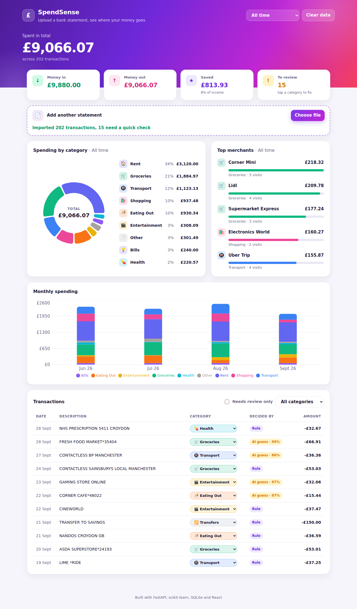
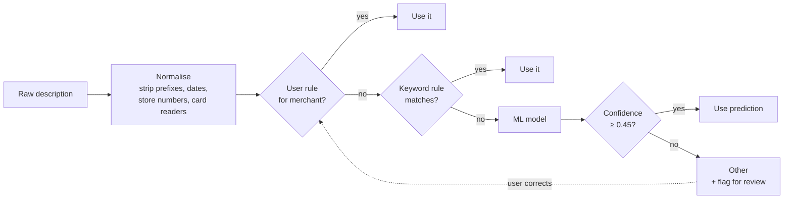
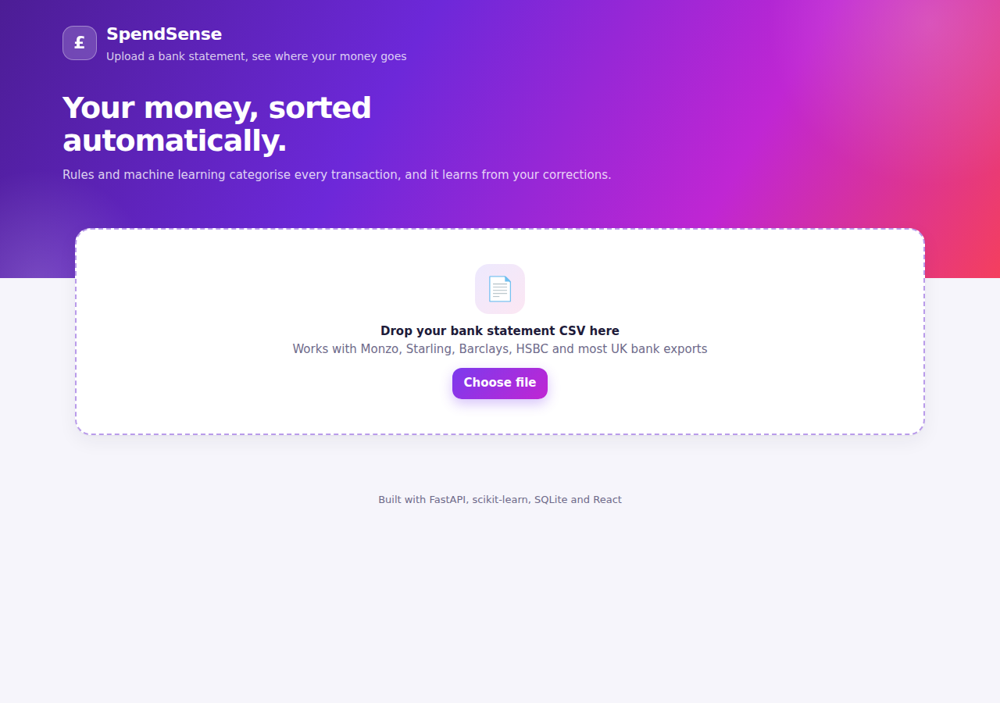
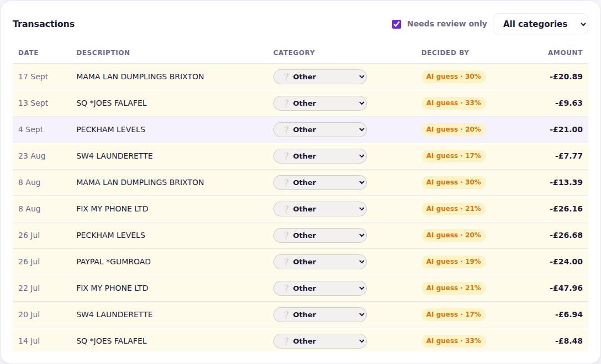
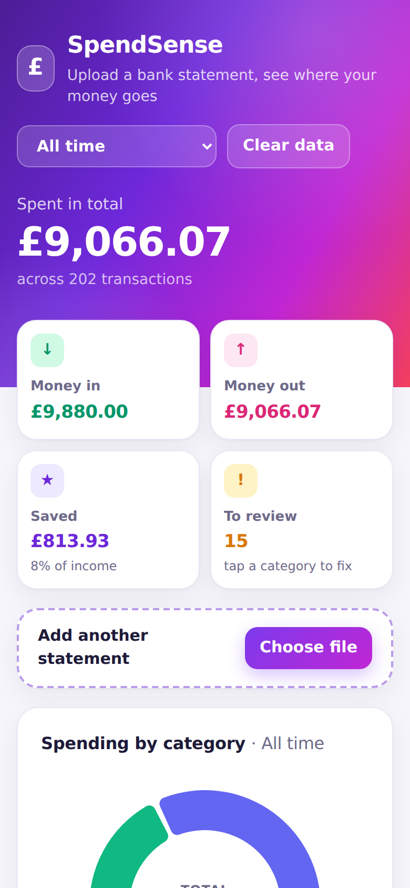

# SpendSense

Upload a bank statement CSV and see where your money goes. Every transaction is categorised automatically by a hybrid **rules + machine learning** engine, and the app **learns from your corrections**.



## Why I built it

Bank statements are messy. The same shop shows up as `TESCO STORES 3021 LONDON`, `CARD PAYMENT TO TESCO STORES ON 12-10` and `CONTACTLESS TESCO EXPRESS`, and every UK bank exports a different CSV layout. I wanted to see how far a small, explainable system could get at turning that mess into something useful, and to be honest about where it fails.

## Features

* **Works with most UK bank exports.** Detects the column layout automatically (signed `Amount` or separate `Paid in` / `Paid out`, six date formats, `£`, commas, brackets for negatives, BOM).
* **Hybrid categoriser.** Known merchants are matched by rules; unknown ones go to a TF-IDF + logistic regression model; anything the model is unsure about is flagged for review instead of guessed.
* **Learns from you.** Correct one transaction and the app saves a rule for that merchant, relabels its other transactions, and gets it right on every future import. All three steps run in one database transaction.
* **No double counting.** Re-importing an overlapping statement skips rows already stored (SHA-256 fingerprint per row), while still keeping two genuinely identical purchases on the same day.
* **Dashboard.** Income, spending and savings rate per month, spending by category, top merchants, monthly trend, and a transactions table where every category is editable. Responsive on mobile, with automatic dark mode.

## How a transaction gets its category



Rules are fast, exact and explainable, but only cover merchants someone has written down. The model generalises to merchants it has never seen (`NEPTUNE PIZZERIA` looks like eating out). The review flag means a wrong guess is visible rather than silently skewing your totals.

## Results

The model is evaluated with **5 fold cross validation grouped by merchant**, so every merchant in a test fold is one the model has never seen. A plain random split would leak `TESCO 123` into training and `TESCO 456` into testing and report inflated numbers.

| Merchants never seen in training | Accuracy | Auto categorised | Accuracy when auto categorised |
|---|---|---|---|
| All | 85.3% | 85.6% | **96.0%** |
| Independent businesses (`PHOENIX PHARMACY`) | 99.1% | 99% | 99.4% |
| Chain brands (`ODEON`, `ZARA`) | 56.2% | 57% | 83.4% |

What this shows:

* When the name contains a descriptive word (pharmacy, kebab, taxi), the model is reliable.
* A brand name on its own carries almost no signal; nothing in the letters of `ZARA` says "clothes". That is exactly why known brands are handled by rules, and why the confidence threshold sends the uncertain ones to the user.
* Honest caveat: the training data is **synthetic** (generated by `scripts/generate_data.py` from merchant lists and real world description templates), so the independent business figure is optimistic; real names are more varied. Swapping in a labelled real dataset would be the first step before trusting these numbers.

Reproduce with `python scripts/evaluate.py`.

## Screenshots

| Start screen | Review queue | Mobile |
|---|---|---|
|  |  |  |

## Tech stack

| Layer | Choice | Why |
|---|---|---|
| API | Python, FastAPI | Typed request validation, automatic docs at `/docs` |
| ML | scikit-learn | Character and word TF-IDF features, logistic regression; small, fast and inspectable |
| Storage | SQLite, plain SQL | Every query is visible; indexes on date and category; a Python function registered inside SQLite so merchants can be grouped in SQL; one connection per request with WAL mode so concurrent requests never lock each other |
| Frontend | React, Vite, Recharts | Upload, charts and inline editing |
| Delivery | Docker Compose, nginx, GitHub Actions | One command to run; tests and evaluation on every push |

## Run it

**With Docker**

```bash
docker compose up --build
# open http://localhost:8080 and upload sample_data/sample_statement.csv
```

**Without Docker**

```bash
# terminal 1
cd backend
pip install -r requirements.txt
uvicorn app.main:app --reload        # API on :8000, docs on :8000/docs

# terminal 2
cd frontend
npm install
npm run dev                          # app on :5173
```

## API

| Method | Endpoint | Purpose |
|---|---|---|
| `POST` | `/api/import` | Upload a CSV; returns inserted, duplicates skipped, needing review |
| `GET` | `/api/transactions?month=&category=&needs_review=` | List and filter |
| `PATCH` | `/api/transactions/{id}` | Correct a category; learns the merchant |
| `GET` | `/api/summary?month=` | Income, spending, net, by category, top merchants |
| `GET` | `/api/trends` | Spending per month per category |
| `GET` | `/api/months` | Months that have data |
| `DELETE` | `/api/data` | Clear everything |

## Tests

```bash
cd backend && pytest -q     # 27 tests
```

Parser edge cases (formats, currency symbols, bad dates with line numbers), categoriser priority order (user rule, then longest keyword, then ML), and API behaviour end to end: import totals, duplicate skipping, learning from corrections across imports, and validation errors.

## Project structure

```
backend/
  app/parser.py         CSV layout detection and cleaning
  app/categoriser.py    rules, ML model, confidence threshold
  app/db.py             schema and SQL queries
  app/main.py           FastAPI routes
  scripts/              data generation and evaluation
  tests/
frontend/src/
  App.jsx, components/  dashboard, charts, editable table
sample_data/            a four month example statement
```

## What I would do next

* Train and evaluate on real, anonymised transaction data.
* Retrain the model periodically from user corrections, not just store them as rules.
* Detect recurring payments and subscriptions automatically.
* Monthly budgets per category with alerts.
* User accounts and authentication so it can be hosted for more than one person.
